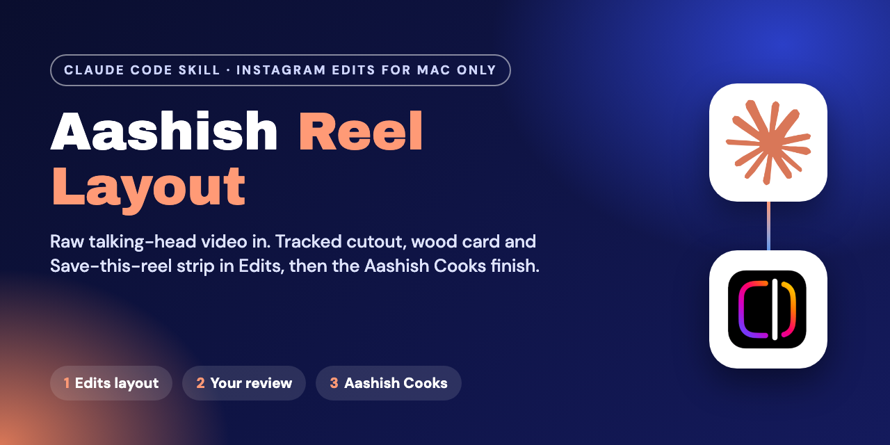
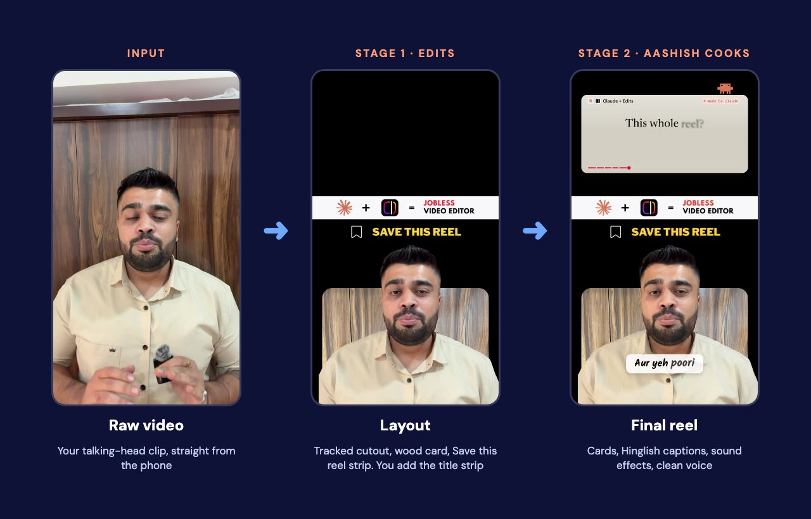

# Aashish Reel Layout



A Claude Code skill that turns a raw talking-head video into Aashish's reel style.

> **Instagram Edits for Mac only.** The skill drives the Instagram Edits desktop app through its built-in automation server. It does not work with the Edits iPhone app, CapCut, Premiere or any other editor.



## What it does

**Stage 1: layout in Edits.** You give Claude a raw vertical video. It builds one Edits project:

- a cutout of you, tracked through the whole clip,
- a wooden photo card behind you, with rounded top corners,
- a black frame, with the top area left free for visuals,
- the "Save this reel" strip above your head.

Claude checks frames across the clip, saves the project and stops. You review it in Edits, fix anything you want, and add your own title strip and screen recordings.

**Stage 2: the Aashish Cooks finish.** After your OK, Claude exports the project and adds cards, Hinglish handwritten captions, sound effects and a cleaned voice. Captions sit on your chest, never on your face or on screen recordings. Tokens, API keys and QR codes in recordings are pixelated, and a few key clicks get a click effect.

**Stage 3 (only when asked).** A reel caption, a guide document and a digital product listing.

## Requirements

- A Mac with **Instagram Edits for Mac** installed and logged in.
- Edits automation server on: Edits > profile icon > **Automation** > **Enable Automation Server**.
- Claude Code connected to Edits: on the same Automation page, under Connect an AI client, copy the **Claude Code** command and run it in Terminal. Start a new Claude Code session afterwards.
- **For stage 2:** the [Aashish Cooks](https://github.com/Aashishb4u/video-skill-aashish-cooks) skill. Without it, stage 1 still works and stage 2 stops with an install link.
- ffmpeg (`brew install ffmpeg`).

## Install

```bash
git clone https://github.com/Aashishb4u/video-skill-reel-layout.git
```

```bash
ln -s "$(pwd)/video-skill-reel-layout" ~/.claude/skills/aashish-reel-layout
```

Install Aashish Cooks the same way, linked as `~/.claude/skills/aashish-cooks`. Then start a new Claude Code session.

## How to use it

**1. Send the raw video**

```
/aashish-reel-layout stage 1
Raw video: ~/Movies/my_reel.MP4
```

If the cutout leaks around your head or shoulders, Claude asks you to right-click the clip in Edits, choose **Cutout**, then **Track object**, and tell it when it's done.

**2. Review in Edits.** Fix anything you like, add your title strip and screen recordings.

**3. Finish it**

```
/aashish-reel-layout stage 2
Project: my_reel layout
0-3.5s: intro, leave untouched
3.5-22s: auto, make it interesting
22-52s: screen recording, blur tokens/API keys/QR codes, click effects on key clicks only
52s-end: auto, end on the comment CTA
Clean my voice. Captions in Hinglish, on my chest, not on my face or the recordings.
```

Change the time ranges and the topic for each reel. Always watch the result before posting.

## Make it yours

The layout uses Aashish's assets. Replace them with your own, keeping the same names and sizes:

| File | What it is | Size |
|---|---|---|
| `assets/wood.jpg` | Background photo behind the cutout | 1500x2000 |
| `assets/save-this-reel.png` | Strip above the head | 1000x100 |

The cutout position and scale in `SKILL.md` are tuned to Aashish's framing. If you film closer or farther away, adjust them after the first run.

## Files

| Path | What it is |
|---|---|
| `SKILL.md` | The skill instructions Claude follows |
| `assets/` | The wood photo and the Save this reel strip |
| `scripts/click_ripples.py` | Draws click effects on chosen clicks in screen recordings |
| `scripts/chunk_words.py` | Transcribes Hinglish audio in overlapping chunks so no words are dropped |
| `docs/` | Images used in this README |

## Notes

For personal use among friends. Unofficial: not affiliated with Meta, Instagram or Anthropic. The Edits automation server is not publicly documented and can change when the app updates.
